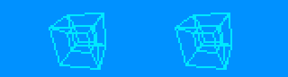

# g13pad

[](https://github.com/nyanmeister/g13pad/actions/workflows/ci.yml)

A Linux driver and configuration app for the Logitech G13 gaming keypad. You get key
bindings and profiles, the backlight colour, pictures, text and animations on the LCD, a
live health meter for games, and an optional analog stick that games see as an Xbox
controller.

RetroArch and Dolphin can also show a [local RetroAchievements progress bar and queued
unlock notifications](docs/retroachievements.md), using their existing login without a Web
API key; `g13map ra launch` starts RetroArch with the game readers attached, and two games
have readers of their own (`g13map ra fzero`, `g13map ra bn2`: F-Zero GX race data and
[Battle Network 2](docs/battle-network-2.md) style progress).

Here is the editor, opened with `g13map edit`:


## What is in the box

- **`g13d`**, the driver (C++). It talks to the pad over USB and turns key presses into
  keyboard events, so games and desktops see an ordinary keyboard.
- **`g13map`**, a small command-line tool and background watcher (Rust). It applies
  profiles, feeds the LCD, switches profiles with the game in front of you and reports to a
  panel applet.
- **`g13map-editor`**, the graphical editor (Rust), launched with `g13map edit`. It is
  optional: everything it saves is a plain text file under `~/.config/g13map` that the
  CLI reads too.
- **`g13pad-analog`**, the adapter that makes the stick an Xbox-style controller.
- **Game observers** that wrap a Steam launch and feed the meter without a mod:
  `g13map-factorio`, `g13map-everspace`, `g13map-noita`, `g13map-goldsrc`, `g13map-terraria`; the mods and
  scripts for the other games are in `contrib/`.
- **`g13music`** and its service, the MPD listening-history companion (SQLite), and
  **`g13pad-obs`**, the OBS source plugin, with `g13map-obs` for the same picture as a
  window without OBS.
- **`g13map-anim`** and **`pbm2lpbm`**, for the built-in scenes and LCD bitmaps from a
  terminal.
- systemd services, udev rules and an Arch package recipe.

Builds and package staging never touch the running system. Everything works on any X11
desktop: window rules (profile switching by focused window) follow i3 and sway through
their IPC, every other X11 window manager through the EWMH root-window properties, and
Wayland compositors through the foreign-toplevel protocol (KDE and GNOME on Wayland: their
X11 clients only). Panel applets exist for LXQt, XFCE and Waybar.

## On the LCD




Two of the built-in LCD animations, shown in the panel's own two colours (sampled from a
video of the glass). The editor's **Animations** view previews all of them live and
keeps one with a click:


The **health meter** turns the panel and the backlight into a live readout of the game in
front of you: a monitor trace that beats faster as health falls, a bar with notches at
the band edges, a hatched shield bar (solid with a helmet), and the backlight by band:
green above 75, yellow, orange, red with a flash on every beat, blue over 100 for an
overshield, and three dark seconds on a drop to zero before the search for a pulse.

A game feeds it one line at a time through a small mod or script. Feeders for Deep Rock
Galactic (with an [installer](contrib/drg-health/README.md) for its UE4SS mod), the Doom
engines, GoldSource and Source engine games, Terraria, ULTRAKILL and
Dwarf Fortress are in `contrib/`; Counter-Strike 2 posts straight to the watcher; Factorio
and Noita are read from outside the game by an observer that wraps the Steam launch
(`g13map-factorio %command%`, `g13map-noita %command%`: no mod, so achievements keep
unlocking). Noita's screen shows the held wand's spell deck as its real icons with the
next cast framed, its mana and recharge, and the death tally; see
[the health meter](docs/health-meter.md) for every game. In the editor, click the screen and choose the game's
entry under **Shows**, so the window rules put it on the game's windows; the profile's
own picture stays kept and returns when the choice goes back to **Picture**.
EVERSPACE's separate **Ship hull, shields and energy** display uses steady hull-band
colour without a heartbeat, plus repair capacity, time until shield recharge and
energy endurance/recovery. Its [configurable installer](contrib/everspace-health/README.md)
sets up the native Linux observer and an optional profile/window rule.
ULTRAKILL also has a separate Combat view for accuracy, average style points per
minute and deaths; its [installer](contrib/ultrakill-health/README.md) preserves the Health view.
`g13map health demo` runs the states on your own panel. See
[the health meter](docs/health-meter.md) and, for adding a game, [AGENTS.md](AGENTS.md).

The same list, under **This computer**, has three machine-wide displays.
**Computer load** shows CPU, memory and I/O stalls with a 90-second history.
**Microphone and volume** shows default mic/output state and a scrolling mic-level
history, with red backlight for a muted mic and green for an open mic. A key's **Sound**
tab provides mic mute/gain and output mute/volume controls. A profile shows one thing at
a time; the saved picture is kept underneath. See [System pressure](docs/system-pressure.md)
and [System audio](docs/system-audio.md).
**Coding agent turn** shows Claude Code or Codex activity, a turn stopwatch,
background agents and a green ready screen. Questions blink slowly in the current
turn colour; automatic review stays steady yellow, while human permission requests
blink yellow. Explicitly reported denials blink red three times, then hold.
Long activity labels scroll with a one-second hold at each end. See
[agent setup and event limits](docs/agent-display.md) for the harness hooks.

[MPD listening history and music controls](docs/mpd-music.md) add an independent
SQLite companion service, G13 Music bindings, and queued album/smart shuffle.
The driver only emits action tokens; history and playback policy live outside it.

[MPD playback](docs/mpd-statistics.md) (**Music (MPD): what is playing**) shows Artist - Title,
qualified plays and last played date, elapsed/remaining time, and an MPD-only audio
level history. The graph freezes on pause and survives profile switches.

[mpv playback](docs/mpv-playback.md) adds decoder, recent frame drops, A/V sync,
buffering and GPU pass timing, with elapsed/remaining time above a full-width
progress bar. Choose **mpv: what is playing** under **Shows** and install the passive mpv script.

[Dwarf Fortress with DFHack](contrib/df-health/README.md) has a fixed fortress
overview: care, impaired limbs, worn clothing, weather and temperature. Its detail
line scrolls hospital shortages and strange-mood requirements, while the backlight
follows the calendar season. Adventure mode follows the controlled character's
injuries, exertion, blood and limb function, with separate ally and pet counts.
Travel shows live needs and party membership while local health is unavailable.
The collector reads the game without changing it.

## Install

The supported route is an OS package: it installs the services, udev rules and group
access together, and keeps your changed startup bindings and calibration across upgrades.

On Arch, download `PKGBUILD` and `g13pad.install` from the
[0.3.7 release](https://github.com/nyanmeister/g13pad/releases/tag/v0.3.7) into an
empty directory and run `makepkg`. That recipe downloads the source archive and
verifies its SHA-256 checksum. xboxdrv is an optional separate dependency, not bundled.

For a local checkout, export a committed tree as `g13pad-0.3.7.tar.gz` with
`git archive --format=tar.gz --prefix=g13pad-0.3.7/ HEAD > g13pad-0.3.7.tar.gz`, put it beside both files
from `packaging/`, and run `makepkg`. The in-tree recipe uses `SKIP` only for this
locally generated archive; published release recipes carry a fixed checksum.

After installing, read [installation and activation](docs/installation.md) for the
services to enable and the group to join, and [migration](docs/migration.md) if an
earlier patched g13 driver is already on the machine. Existing `~/.config/g13map`
profiles are kept.

## Build and check

For game-handler development, start with the [Health Mode architecture and timing
contract](docs/health-architecture.md). Telemetry polling and LCD animation have
independent clocks; the reported display ceiling is 100 FPS.

On Arch install the build dependencies `base-devel cmake ninja rust libusb libevdev libpulse
libmpdclient sqlite log4cpp` (plus `obs-studio jansson lib32-glibc lua` for the OBS plugin,
the 32-bit game modules and the DFHack checks) and the GUI runtime dependencies listed in
[the Arch recipe](packaging/PKGBUILD), including `libglvnd libxkbcommon libxkbcommon-x11
libx11`. A first Rust build downloads the versions pinned by Cargo.lock, one of them a git
dependency (the Noita reader). For an already populated cache, add
`-DG13PAD_CARGO_OFFLINE=ON`.

```sh
./build.sh -DCMAKE_BUILD_TYPE=Release -DCMAKE_INSTALL_PREFIX=/usr -DCMAKE_INSTALL_LIBDIR=lib
./check.sh
```

The checks use mock USB and input devices and private files; no keys or pointer input
reach your desktop.

Options, for when you need them:

- `G13PAD_BUILD_DIR` and `G13PAD_JOBS` select the build directory and job count. Rust
  inherits the job count; override it with `G13PAD_RUST_JOBS` or CMake's
  `-DG13PAD_RUST_JOBS=2`. The conservative default remains two jobs.
- `-DBUILD_TESTING=OFF` omits tests.
- `-DG13PAD_BUILD_EDITOR=OFF` skips the graphical editor and its GUI dependencies, keeping
  the driver, CLI/watcher and analog helper. Also disable `G13PAD_BUILD_CLI` and
  `G13PAD_BUILD_ADAPTER` for the C++ driver only. `G13PAD_BUILD_OBS`,
  `G13PAD_BUILD_GOLDSRC_HEALTH` and `G13PAD_BUILD_SOURCE_HEALTH` (all on) take out the OBS
  plugin and the native game modules; `G13PAD_BUILD_FUZZERS` (off) adds the libFuzzer
  checks.
- In a configured full build, `cmake --build build --target g13d`, `cli`, `editor`,
  `adapter`, `anim`, `obs`, `factorio`, `noita` or `music` builds just that component.
- `-DG13PAD_SANITIZER=address,undefined` with Clang enables instrumented driver checks.

The Rust workspace contains the application (`g13map`), the mapping model (`g13pad-core`),
the adapter (`g13pad-analog`) and the music companion (`g13pad-music`); the core and the
adapter use only the standard library. For a quick helper check:

```sh
cargo test --offline --locked -p g13pad-core -p g13pad-analog
```

See [build profiles and caches](docs/building.md) for lean development tests, full
debugger information and release/package cache reuse.

To inspect what an installation would place, stage it into a directory:

```sh
DESTDIR="$PWD/build/stage" cmake --install build
```

Then look through `build/install_manifest.txt`. Staging creates a package root; it does
not activate services. Prefer an OS package over installing onto an existing system by
hand: CMake's installation copies configuration files and does not merge them.

## Using it

### The command line

A sampler; `g13map --help` lists everything.

```sh
g13map edit                         # editor
g13map status                       # connection, profile and paths
g13map doctor                       # the driver, the stick adapter, the watcher, the profile: what to fix
g13map profiles                     # saved profiles, the active one starred
g13map use gaming                   # apply and select a saved profile
g13map apply                        # reapply the selected profile
g13map profile bind gaming G1 KEY_LEFTCTRL+KEY_D   # a key or chord; PAD_A for a controller button
g13map profile run gaming G5 firefox # a program on a key; g13map-watch starts it
g13map profile run gaming G6 hold arecord -f cd ~/clip.wav  # while the key is held
g13map profile rgb gaming 31 0 127  # backlight; leds, stick, controller, lcd, mic likewise
g13map profile health gaming feed   # the screen shows the meter (off, feed, cs2, log, retroarch, dolphin)
g13map profile pressure gaming on   # or mpv, mpd, audio: the machine-wide displays
g13map modes set 3 gaming           # M1+M2 held selects this profile; modes on|off|show
g13map focus set steam gaming       # window rule by class; focus windows lists them
g13map import FILE NAME             # keep an existing driver's bindings
g13map marquee 'Message' NAME        # keep reusable LCD text, no hardware write
g13map demo loop.gif 15             # show a file for 15 s; demo scenes, demo scene NAME
g13map-anim keep aquarium           # keep a built-in scene; anim NAME DIR, pbm NAME DIR
g13map health 87 shield 50          # feed the health meter; wait, off, demo, cs2
g13map health source DIR sp         # Source engine game: install the LCD module + page (sp|mp|remove)
g13map health dfhack DIR             # Dwarf Fortress + DFHack: fortress or adventure LCD
g13map-goldsrc %command%             # GoldSource handler for native Half-Life/mods
g13map-factorio %command%            # read-only native Factorio observer, no game mod
g13map-everspace %command%           # native EVERSPACE observer; profile ship NAME on
g13map-noita %command%              # read-only Noita observer (Proton), no mod, achievements stay
g13map-terraria %command%            # Terraria, through its launcher
g13map ra launch                    # RetroArch with achievements and the game readers
g13map audio mic-toggle             # audio inputs|status|COMMAND; music ACTION|status; mpd status
g13map obs                          # the pad as a transparent window; glass matches its colours
g13map panel xfce                   # XFCE Generic Monitor status and editor button
g13map panel waybar                 # Waybar custom-module JSON
g13map panel text                   # i3blocks/Polybar/tint2 or terminal status
g13map --version
```

`profile` commands save files; `use` and `apply` send settings to the device. Syntax and
configuration errors go to stderr without changing the LCD. Missing hardware does not
prevent saved configuration or help/version commands. `g13map status` shows the selected
profile, connection and paths; `g13map doctor` checks the driver, its pipe, the stick's
source node and adapter, the profile, the watcher and the display, one line each with
the fix beside anything wrong, and exits 1 when there is something to fix. The profile
format is plain text, editable with any editor.

Two services do the background work: `g13map-apply.service` restores the saved profile at
login; `g13map-watch.service` switches profiles, plays animations, recovers from temporary
LCD errors and reapplies the profile after a driver reconnect.

### The editor

The board on the left is the pad; click a key, the stick or the screen and the pane on
the right shows what it does and the ways to change it: a key or chord (press it, or
pick it from the list), a controller button, a sound or music action, a program or
script to start under **Program**, or the driver's raw action text under **Advanced**. The screen's pane has one list, **Shows**: the kept
picture, or one of the live displays (game health, achievements, what is playing, the
microphone, the computer's load); the picture stays kept underneath. The bar's
**Window rules** and **OBS** buttons swap the board for those views; **← Board** or
Escape comes back. Every change reaches the pad at once; **Save** keeps it.

The key picker, board and chord labels follow the active X11 keyboard layout and group,
including changes while the editor is open. Bindings keep the physical Linux `KEY_*` code,
not the letter: on a Norman layout the displayed E is `KEY_D`. The raw code is shown beside
the label, and `g13map layout` prints the current translation without a G13 attached.
Without an X display, labels use physical names; native Wayland layout tracking is not
implemented. Games may interpret keys differently, so confirm their own bindings.

Dead keys are identified explicitly. Fontconfig selects an installed fallback font for
international labels; install fonts covering the scripts you use (for example DejaVu Sans
for Hebrew). IME composition and shifted/Caps Lock text are not modeled by these
unshifted key labels.

### A program on a key

Since 0.2.98 a key can start any program or script: the browser, a terminal with a
command inside it, a script of your own. In the editor pick the key, then **Program**, and
type the line as you would at a shell prompt (a path, `~` for home, or a name on `PATH`,
then its arguments, split on spaces), or **Browse…** to it; from the command line,
`g13map profile run NAME KEY PROGRAM [ARGS...]`. A bare name is looked for in
`~/.config/g13map/scripts/` and `/usr/share/g13pad/scripts/` before `PATH`, so a script
dropped in the first folder is usable by name. The program must exist and be executable
when it is set (a script needs its `#!` line and the executable bit); a path with spaces
goes behind a wrapper script or a symlink.

In the profile this is two lines, both plain text:

```
# run G5 alacritty -e htop
bind G5 >RUN:G5;
```

The driver sees only the second: on press it writes the key's name to its output pipe,
and `g13map-watch.service` (which the editor enables when a program is set) looks the key
up in the active profile's `# run` line and starts the program through `systemd-run
--user`, so it has a unit of its own, outlives a watcher restart and logs to your journal
under its own name (`systemctl --user list-units 'run-*'` while it runs). It gets
`G13MAP_KEY`, `G13MAP_PROFILE` and `G13MAP_EDGE` in its environment, so one script can
serve several keys and both ends of one.

Since 0.3.0 the pane's **When** row (hover a choice for the detail) says which end of the
key the program belongs to, and the command line takes the same word before the program:

| When | What happens | In the profile |
|---|---|---|
| Pressed | starts on press (the default; the word is not written) | `# run G5 lights.sh on` |
| Released | starts on release | `# run G5 released lights.sh off` |
| Both | starts on each; the script reads `G13MAP_EDGE` (`press` or `release`) | `# run G5 both lights.sh` |
| Hold | starts on press, stopped (SIGTERM) on release: a recording, a microphone, a light, while held | `# run G5 hold arecord -f cd ~/clip.wav` |

Anything but Pressed binds the key `>RUN:G5; RELEASE:G5;`, so the driver reports the
release too. A held program runs as the unit `g13map-hold-G5`; a second press while it
still runs is refused, not doubled.

### Profiles that follow the game

A profile can carry window rules: when a window of a matching class (`firefox`, `steam`,
the game) has focus, the watcher switches to that profile, and back when it loses focus.
Under i3 or sway the watcher listens on the IPC socket; under any other X11 window manager
it reads the focused window from the root window's EWMH properties; on Wayland it uses the
foreign-toplevel protocol where a compositor offers it, the app id standing in for the
class. The journal says which one it found (`window focus: Xfwm4 on display :0`).
`g13map focus windows` lists the windows the manager knows with their classes and marks
the focused one, so a rule can be written from a terminal; the editor's **Window rules**
view shows the same list.

The M-keys select profiles too: with M-key switching on (`g13map modes on`, or the
checkbox in the same view), the sum of the lit M-keys (M1 = 1, M2 = 2, M3 = 4) picks a
saved profile (`g13map modes set 3 gaming`); MR clears the sum, and a sum with no profile
assigned leaves the current one.

Where it works, as checked on a test machine with the pad attached (details in the
[validation record](docs/validation.md)):

| session | window rules |
|---|---|
| X11: i3, XFCE (xfwm4), KDE Plasma (KWin), MATE (Marco), Openbox, Fluxbox, IceWM, awesome, bspwm, herbstluftwm | yes, all checked |
| Wayland: sway, labwc, wayfire, river 0.3 (`river-classic`), niri | yes, all checked |
| Wayland: Hyprland | expected (it offers the protocol), not checked: it needs a GPU |
| Wayland: KDE Plasma, GNOME | X11 clients only (Steam and every Proton game among them), through their Xwayland; native windows are not followed |
| Wayland: river 0.4 | no (it is a framework that needs a window-manager client) |
| GNOME on X11 | gone upstream (Mutter 51 has no X11 mode) |

### Pictures, text and animations

Images support crop, background, threshold/dither, inversion and animation. Text supports
installed fonts, size, multiline wrapping/alignment and scrolling. The **Animations** view
offers built-in looping pixel art drawn in code (a rainy skyline, a starfield, Pong, Life,
waves, cubes, digital rain, a heartbeat, an aquarium, tesseracts, an orrery); a click keeps
one as a picture.
`g13map-anim` lists the same scenes from a terminal, `g13map-anim keep NAME...` keeps
them, `g13map-anim anim NAME DIR` writes one as `DIR/NAME.anim`, which any installed
`g13map demo` plays without knowing the scene, and `pbm NAME DIR` writes its frames as
bitmaps.

`g13map demo FILE [SECONDS]` shows a file temporarily, then restores the current
display. The default is 10 seconds; fractional seconds are accepted. With no file,
it prints usage and exits. `g13map demo scenes` lists the built-in scenes and `demo scene
NAME` plays one (or a kept `NAME.anim`); `demo --clear` ends a demo left behind by a killed
process. GIF, animated PNG/WebP and ordinary images use the editor
component's decoder without opening a window; white pixels light the LCD. Native
sprite sheets whose dimensions are multiples of 160×43 play left-to-right, then
top-to-bottom, at 200 ms per frame. Driver `.lpbm` and kept `.anim` files also work.
The demo preserves profiles and pictures, yields to an open editor, and restores
the display on Ctrl+C. Example: `g13map demo loop-160x43.gif 15`.

**Show temporary LCD errors** displays errors for five seconds, then restores the latest
normal image or animation frame. The watcher performs the restoration even after the
editor closes and with automatic profile switching off. The setting is on by default.

### The health meter

The meter (0.2.17, pictured above) is fed one line at a time: `g13map health 87` (or
`87/125 shield 40/60`). `wait` is a game connected without health yet (a lobby); `off` or
an expired `ttl` gives the panel back to the profile. The line can carry more than health:
`helmet`, `mana`, `defense`, `breath`, a `deaths` tally, a `count` with a label, `foe` for
the nearest enemy's health, `deck` for a strip of icons with one framed, and the words
single games use (`cap`, `rank`, `style`, `time`, `dash`, `rail`, `battery`, `research`,
`technology`, `attack`, `vehicle`, `pilot`); the [feed contract](docs/notes/feed-contract.md)
has the grammar. The screen is drawn at up to 50 frames a second, the animations counted
in 20 ms ticks. A profile chooses the meter for its screen (`g13map profile health NAME
feed`, or `cs2` for the watcher to run the Counter-Strike 2 Game State listener itself,
`log`, `retroarch` or `dolphin` for the other readers). The ladder, its colours and the
rest of the look are lines in `~/.config/g13map/meter`, re-read live. See
[the health meter](docs/health-meter.md).

### The OBS source

`g13pad-obs` (0.2.41) is an OBS plugin: **G13 pad (g13pad)** in the Sources list, beside
the input-overlay ones. It draws the pad in the style of the plugin's pixel keyboard,
keys lit cyan as the pad reports them (whatever the profile binds them to), the stick
cap travelling, and the LCD showing the frame on the glass in the backlight's colour.
Its properties: the picture (the pad, or the LCD alone at a chosen size) and a sheet
folder for a repaint. No window is involved; it reads the driver's state files.

The sheet is in the plugin's own shape (`assets/obs/g13.png` with `g13.json`, installed
under `/usr/share/g13pad/obs/`; each key's sprite, its pressed twin 3 px below). A
repainted copy in `~/.config/g13map/obs/` is drawn instead. The driver writes its state
beside its pipes: `/run/g13d/g13-0_keys` (`stick X Y`, `backlight R G B`, `keys G1 M2
...`, rewritten on change) and `g13-0_lcd` (the 960-byte frame last sent to the glass).
Anything else can read them.

The LCD and the keys share the one backlight: the pad has a single RGB zone (feature
report 7; the kernel's `hid-lg-g15` driver says the same), so they cannot be lit in
different colours, and the glass only looks paler than the keys because of its diffuser.
The G13's LEDs are not a monitor's primaries, so `~/.config/g13map/glass` translates
backlight values to what the glass shows; the source, the overlay window and the
README's GIF draw through it. `g13map glass` (0.2.42, glow 0.2.43; also the OBS panel's **Match the
glass…**) fills it in by eye: a course of backlight colours (each LED alone, all three,
then every colour your profiles and the health meter use), each set on the pad while the
window shows the LCD as the screen will draw it; drag the colour until the two agree and
step on. Three matches fix a fit (the LEDs add linearly, so the monitor colour of each LED
alone gives every mix), the later steps start from its prediction, and Save writes the
file (`R G B  R G B` matched pairs, `glow` for how many times the background's light a
lit pixel passes, the same colour brighter and only paler where a channel has no headroom,
`fit` for the rest), which the windows and the source pick up as soon as it changes.
`g13map glass fit` re-solves the fit after a hand edit.

Without OBS, or on a machine without the plugin, `g13map obs` (0.2.39) is the same
picture as a borderless transparent window ("G13 overlay"; `--lcd N` the LCD alone as
"G13 LCD"; `--dump DIR` writes the sheet for repainting; `--help` has the rest), and
the editor's **OBS** view (0.2.40) opens and closes those windows. A window must stay
on a visible workspace to be captured; the plugin needs nothing of the kind.

### Panel applets

For XFCE, add a Generic Monitor item, set its command to `g13map panel xfce`, hide its
extra label, and use a 30-second update interval. It shows the device icon, the active
profile's name beside it and driver availability; clicking the icon or text opens the
editor. `g13map panel name off` (or the editor's Window rules view) leaves the icon by
itself. LXQt's existing custom-command output remains the default with no arguments. See
[panel setup](docs/installation.md#panel-applets) for settings and optional dependencies.

### The analog stick

The key editor's **Controller** tab binds G-keys and thumb buttons to the same
Xbox-compatible controller as the stick: A/B/X/Y, LB/RB, LT/RT, D-pad directions,
Back/Start/Guide and L3/R3. Picking a controller binding selects analog mode for
the profile; other keys can retain keyboard bindings. Digital triggers send full
pressure while held and zero on release. Click the stick itself for what pressing it sends.
See [controller bindings](docs/controller-bindings.md) for setup and CLI usage.

Analog support defaults to the left controller stick and its click to L3, preserving
normal board keyboard events. The stick's pane (click the stick on the board) changes the
output stick, click button, axis swap and flips per profile. Apply changes the live adapter; Save
keeps them, Revert restores the saved mapping, and Use defaults removes the override.
Calibration continues to follow physical X/Y when axes are swapped.

`/etc/g13/analog.conf` contains a dead zone and optional **device-specific** calibration.
`g13pad-analog check FILE` validates it without accessing hardware. The updated
helper/services and group access are required for custom mappings.

The adapter follows the cable (0.3.0): the source node carries a systemd device unit and
`g13-analog.service` is bound to it, so a pad that drops off USB stops the adapter at
once instead of leaving xboxdrv on a vanished node, and the watcher starts it again with
the profile when the pad is back. `g13map doctor` says if the adapter is on a stale node,
if the node lacks its unit (an older rule file; replug or `udevadm trigger`), and what
else the pad needs.

An optional [G13 Analog Steam Input template](packaging/steam-g13-analog.vdf) preserves
continuous gamepad axes instead of converting them to keyboard directions. See
[Steam Input setup](docs/steam-input.md). A template cannot make a game consume analog
input if its controller input path is inactive.

## Current limits

Validated on Linux x86_64 with systemd, and only there: the services, the device binding
and the program keys' transient units are systemd's. Window rules follow i3 and sway
through their IPC, any X11 window manager, and Wayland compositors with the
foreign-toplevel protocol; on KDE Plasma and GNOME under Wayland only their X11
(Xwayland) clients. Pointer isolation targets X11/libinput. One G13 and one controlling
login session are the initial scope. The inherited FIFO protocol requires coordinated
writes; unrelated direct writers or multiple controlling sessions can bypass the editor's
lock. A physical reconnect has been checked on the pad (the adapter follows it since
0.3.0); a fresh login and cross-distribution installation still need their own checks.
Native Waybar and GNOME/KDE integrations were not exercised.

The physical test pad is connected to a server and passed through to a VM, isolating
driver faults, generated input and GUI tests from the working desktop. Optional
[host-side USB reconnect rules](docs/vm-usb.md) refresh a stale live attachment after a
physical replug; these files are not installed by the desktop package. Automated mocks do
not establish physical gameplay or cross-distribution results. The
[validation record](docs/validation.md) has every check by version, its limits and the
build-cache lessons.

## License and contributions

Original code and modifications are **GPL version 3 or later**, chosen by the project owner.
Upstream public-domain/MIT notices and dependency/font licenses are retained. See
[LICENSE](LICENSE), [NOTICE](NOTICE.md), and [source provenance](docs/provenance.md).
Original device artwork replaces upstream branded/game assets.

[Contributing](CONTRIBUTING.md) explains checks, useful bug reports and how source is
published. The private development history, migration records and site-specific upgrade
scripts stay with the owner's maintenance notes; this README describes the consolidated source.

## Authors

- **nyanmeister**: owner, design, every hardware check and every report from the glass.
- **Claude (Fable 5.1, Anthropic)**: the `g13map` editor, CLI and watcher, LCD pictures,
  text and the built-in animations, i3 window rules, M-key profile modes.
- **Codex (GPT-6, OpenAI)**: driver consolidation and the imported fixes, packaging,
  services and permissions, the lean CLI split, the analog adapter, native game-health
  observers, Factorio vehicle gauges and gear animation, research marquee, DFHack
  fortress overview and seasonal backlight, Adventure condition and travel displays,
  validation records.
- **Claude (Opus 4.8, Anthropic)**: the initial coding-agent display and Claude Code hooks.
- **Codex (gpt-6.1-sol, OpenAI)**: native Codex hooks, agent alerts, scrolling labels,
  question lifecycle and release validation.

Commits carry the assistant and model that wrote them.
